<!-- Palette (60-30-10) 60% #0d1117 deep night (backgrounds) 30% #161b22 / #8b949e slate + soft grey (cards, text) 10% #58a6ff electric blue (accent only) -->  
 

  

   
   

text
┌──────────────────────────────────────────────┐
│                                              │
│   I turn ambitious ideas into polished       │
│   products, blending engineering and         │
│   design into experiences worth              │
│   remembering.                               │
│                                              │
└──────────────────────────────────────────────┘

  
 ◦  now
yaml
studying:  algorithms, databases
shipping:  small tools that solve my own problems
learning:  something new every week
looking:   internships, relocation welcome
 
 ◦  toolkit

          
  
 ◦  the snake is hungry

 <picture> <source media="(prefers-color-scheme: dark)" srcset="https://raw.githubusercontent.com/rajkirankr-beep/rajkirankr-beep/output/github-snake-dark.svg" /> <source media="(prefers-color-scheme: light)" srcset="https://raw.githubusercontent.com/rajkirankr-beep/rajkirankr-beep/output/github-snake.svg" />  </picture>

every commit you see is a commit it eats

  
 ◦  say hi

  

 

 