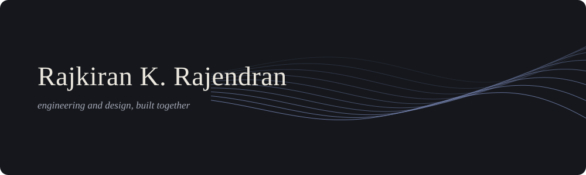

  

 

I'm a student at IIIT Kottayam, Kerala. 
I like building the whole thing: the interface people touch and the system underneath it.

 

**Open to internships. Happy to relocate.**

 

<h3 align="center">Now</h3>

Studying algorithms and databases 
Shipping small tools that solve my own problems 
Learning one new thing every week

 

<h3 align="center">Tools</h3>

React &nbsp;/&nbsp; Flutter &nbsp;/&nbsp; Dart &nbsp;/&nbsp; JavaScript &nbsp;/&nbsp; Python 
Java &nbsp;/&nbsp; C &nbsp;/&nbsp; Firebase &nbsp;/&nbsp; Git

<!--
Add a "Work" section here once you pin 2-3 repos. One line each on the problem it solves:

<h3 align="center">Work</h3>

  <a href="https://github.com/rajkirankr-beep/REPO"><b>Repo name</b></a> 
  One line on what it does and who it is for.

-->

 

  <picture>
    <source media="(prefers-color-scheme: dark)" srcset="https://raw.githubusercontent.com/rajkirankr-beep/rajkirankr-beep/output/github-snake-dark.svg" />
    <source media="(prefers-color-scheme: light)" srcset="https://raw.githubusercontent.com/rajkirankr-beep/rajkirankr-beep/output/github-snake.svg" />
    
  </picture>

 

<h3 align="center">Contact</h3>

<a href="mailto:rajkirankrajendran@gmail.com">rajkirankrajendran@gmail.com</a> 
<a href="https://www.instagram.com/ra._.kiran/">Instagram</a>
<!-- Add LinkedIn when ready:  &nbsp;/&nbsp; <a href="https://linkedin.com/in/YOUR-HANDLE">LinkedIn</a> -->

